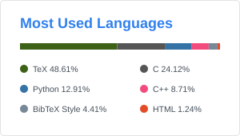

# Hi, I'm Zhijian Qiao.

I work on **world models and spatial understanding** for robotics and autonomous driving.

PhD candidate at HKUST, advised by Prof. Shaojie Shen.

[Website](https://qiaozhijian.github.io/) · [Google Scholar](https://scholar.google.com/citations?user=R1ybYxoAAAAJ) · [Email](mailto:zqiaoac@connect.ust.hk)

  
  

Snapshot: 2026-10-10 · Private aggregates included · [Statistics scope](STATS.md)
